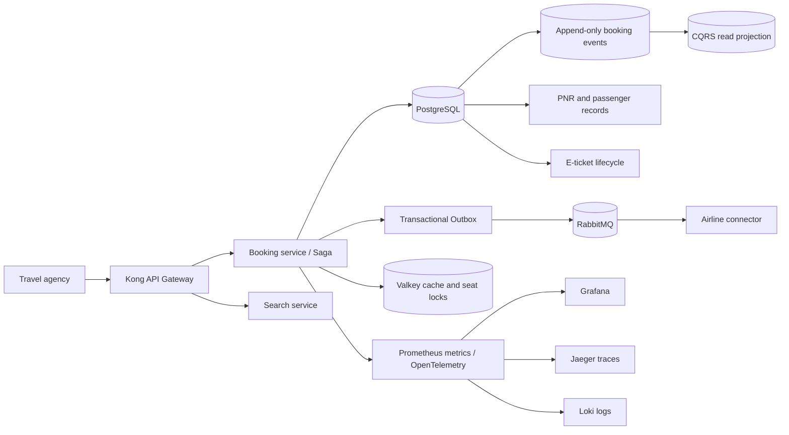

# AeroBooking Enterprise — implementación y operación

## Enterprise logical view



## Alcance incorporado

Esta evolución conserva el Caso 9 y el alcance Complete previo, y añade:

- **CQRS:** `bookings` sigue siendo el modelo transaccional de escritura; `booking_read_model` es la proyección de consulta. Las consultas `/v2` leen la proyección y el endpoint administrativo permite reconstruirla desde el event store.
- **Event Sourcing híbrido:** `booking_events` registra eventos de creación, cambios de estado, pasajeros y emisión/anulación de tiquetes. Tiene versiones por reserva y un trigger impide `UPDATE`/`DELETE`. El procedimiento `rebuild_booking_read_model()` reconstruye la vista de consulta a partir de los últimos eventos de estado. La tabla `bookings` se conserva como agregado operacional para no romper la Saga existente; por eso se documenta como enfoque híbrido de event log/event sourcing, no como una migración total del write model a event sourcing puro.
- **PNR:** se genera automáticamente al crear la reserva y queda asociado a la agencia. La consulta se realiza mediante `GET /v1/pnrs/{pnr}`.
- **Pasajeros:** `POST /v1/bookings/{bookingId}/passengers` agrega pasajeros ADT/CHD/INF. El número de documento no se almacena en claro; solo se conserva un hash SHA-256 de referencia. No usar este almacenamiento demo como repositorio legal de documentos de viaje.
- **Tiquetes electrónicos:** al confirmar la aerolínea y completar la Saga, PostgreSQL genera un tiquete determinístico `ETK-...`. Se puede consultar en la respuesta CQRS; emitir de nuevo es idempotente. La anulación se realiza mediante `POST /v1/tickets/{ticketNumber}/void`. La compensación de Saga también anula el tiquete si existiera.
- **Idempotencia reforzada:** el mismo `Idempotency-Key` con el mismo contenido reproduce la respuesta; reutilizarlo con contenido diferente devuelve HTTP 409. El hash se calcula sobre vuelo, asiento, tarifa y método de pago. Se cubre la carrera de inserción mediante la restricción única de Saga y relectura tras conflicto.
- **Versionamiento de API:** se mantiene `/v1` y se agrega `/v2` para consultas CQRS e historial de eventos. Kong expone las rutas y `scripts/bootstrap.js` las conserva al regenerar configuración.
- **Contratos:** `contracts/openapi.json` documenta los recursos y modelos principales.
- **Carga:** `load/booking-read.js` ejecuta una prueba gradual con k6.
- **Caos controlado:** `scripts/chaos-airline.ps1` detiene y vuelve a iniciar el conector de aerolínea para observar Circuit Breaker, Saga y recuperación.
- **Backups:** `scripts/backup.ps1`/`scripts/backup.sh` generan `pg_dump` en formato custom y checksum SHA-256. `scripts/restore.ps1` restaura con confirmación explícita.
- **CI:** `.github/workflows/ci.yml` ejecuta tests, validación sintáctica, y `docker compose config` en GitHub Actions.
- **Grafana:** `aerobooking-enterprise.json` añade paneles de eventos, Outbox, conciliación, tiquetes, latencia de booking y consultas PNR.

## Rutas nuevas

| Método | Ruta | Propósito |
|---|---|---|
| GET | `/v2/bookings` | Listado paginado por agencia desde CQRS |
| GET | `/v2/bookings/{bookingId}` | Modelo de lectura CQRS |
| GET | `/v2/bookings/{bookingId}/events` | Historial de eventos de reserva |
| POST | `/v2/admin/projections/rebuild` | Reconstruir proyección; requiere scope `admin` |
| GET | `/v1/pnrs/{pnr}` | Consultar PNR de la agencia autenticada |
| POST | `/v1/bookings/{bookingId}/passengers` | Añadir pasajero |
| GET | `/v1/bookings/{bookingId}/passengers` | Listar pasajeros |
| POST | `/v1/bookings/{bookingId}/tickets/issue` | Recuperar/emitir tiquete solo con booking confirmado |
| POST | `/v1/tickets/{ticketNumber}/void` | Anular tiquete emitido |

Todas las rutas de negocio requieren JWT y scopes. Las rutas `/v2` y PNR/ticket pasan por Kong y el plugin JWT de la ruta booking.

## Instalación nueva

```powershell
Copy-Item .env.example .env
.\scripts\start-local.ps1
```

The helper checks Docker Desktop, validates Compose, builds and starts the stack, waits briefly, and prints the local URLs. You can also run `docker compose config` and `docker compose up --build -d` manually.

`infrastructure/postgres/init.sql` contiene el esquema inicial y la migración Enterprise `003-enterprise.sql` para bases nuevas. El servicio one-shot `db-migrate` aplica esa migración de forma idempotente también sobre volúmenes existentes antes de iniciar `booking-service`.

## Actualización de una instalación existente

No borrar volúmenes. Primero crea un backup y luego ejecuta `docker compose up --build -d`. El servicio `db-migrate` espera a PostgreSQL, aplica `003-enterprise.sql` y finaliza antes de que arranque `booking-service`. Si necesitas aplicarla manualmente:

```powershell
docker compose up -d postgres
Get-Content .\infrastructure\postgres\migrations\003-enterprise.sql -Raw | docker compose exec -T postgres psql -U aerobooking -d booking_db
docker compose up --build -d
```

La migración usa `IF NOT EXISTS`/`CREATE OR REPLACE` y puede repetirse; siempre respalda antes de actualizar.

## Pruebas

```powershell
npm test
Get-ChildItem services,packages,scripts,tests -Recurse -Filter *.js | ForEach-Object { node --check $_.FullName }
docker compose config
```

Prueba de carga (instalar k6 gratuito y tener un JWT válido o configurar `CLIENT_ID`/`CLIENT_SECRET`):

```powershell
$env:BASE_URL='http://localhost:8000'
$env:CLIENT_ID='demo-client'
$env:CLIENT_SECRET='demo-secret-change-me'
k6 run .\load\booking-read.js
```

Prueba de caos controlado:

```powershell
.\scripts\chaos-airline.ps1 -Action stop -Seconds 20
```

Backup y restauración:

```powershell
.\scripts\backup.ps1
.\scripts\restore.ps1 -BackupFile .\backups\aerobooking-YYYYMMDD-HHMMSS.dump
```

On Linux/macOS, use `scripts/backup.sh` and `scripts/restore.sh <backup.dump>`.

## Demostración recomendada

1. Obtener token B2B de una agencia.
2. Buscar tarifa, bloquear asiento y crear reserva con `Idempotency-Key`.
3. Repetir la misma petición: debe responder `replayed=true`; cambiar el contenido conservando la clave debe devolver 409.
4. Consultar `/v2/bookings/{id}` y `/v2/bookings/{id}/events` para mostrar proyección, PNR y eventos.
5. Agregar pasajero; comprobar evento `booking.passenger_added`.
6. Confirmar una reserva: mostrar tiquete generado. Anularlo y verificar evento `ticket.voided`.
7. Ejecutar `POST /v2/admin/projections/rebuild` con credencial de administrador y comprobar que la lectura sigue consistente.
8. Detener el conector de aerolínea; observar métricas/alertas y trazas en Grafana/Jaeger.
9. Ejecutar reconciliación y mostrar hallazgos en modo report-only.
10. Crear backup y verificar checksum.

## Decisiones y trade-offs

- **CQRS híbrido en vez de duplicar microservicios:** menor complejidad operativa para un despliegue local, con una proyección separada y reconstruible.
- **Event log append-only en PostgreSQL:** consistencia transaccional con el agregado de booking y facilidad de inspección; a cambio, la escritura no es un event store distribuido independiente.
- **PNR/ticket local simulados:** identificadores y estados reproducibles para la sustentación; no equivalen a emisión certificada de un BSP/ARC ni integración real con aerolíneas.
- **Idempotencia por agencia + clave + hash:** evita duplicar la compra y detecta reutilización incorrecta; la retención de claves debe definirse para producción.
- **k6 y chaos scripts son herramientas de validación:** umbrales de prueba son objetivos de laboratorio, no un SLA de producción.
- **Backups PostgreSQL:** cubren la base transaccional; para recuperación completa también deben respaldarse secretos, configuración y datos persistentes de otros componentes según el RPO/RTO requerido.

## Límites antes de producción

El sistema sigue siendo un prototipo académico con proveedor de aerolínea simulado, pagos internos de demostración y credenciales de desarrollo. Antes de producción se requiere integración real de pagos/GDS, cifrado y política de retención de PII, gestión externa de secretos, restauraciones periódicas verificadas, hardening de red/TLS y pruebas end-to-end/carga en el hardware objetivo.
